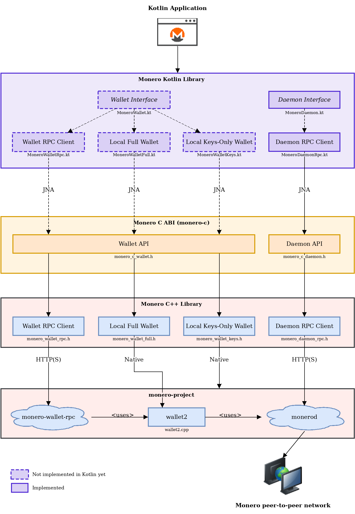

# Monero Kotlin Library

[](https://github.com/libmonero/monero-kotlin/actions/workflows/build.yml)
[](https://github.com/libmonero/monero-kotlin/actions/workflows/unit-tests.yml)
[](https://app.codacy.com/gh/libmonero/monero-kotlin/dashboard?utm_source=gh&utm_medium=referral&utm_content=&utm_campaign=Badge_grade)
[](https://app.codacy.com/gh/libmonero/monero-kotlin/dashboard?utm_source=gh&utm_medium=referral&utm_content=&utm_campaign=Badge_coverage)
[](https://kotlinlang.org/)
[](https://adoptium.net/)
[](https://github.com/libmonero/monero-kotlin/blob/main/LICENSE)

> [!WARNING]
>
> monero-kotlin is under development and unfunded, expect bugs and breaking changes.

A Kotlin library for creating Monero applications using RPC and a C ABI to [monero v0.18.5.3 'Fluorine Fermi'](https://github.com/monero-project/monero/tree/v0.18.5.3).

* Supports a daemon RPC client.
* Daemon implementations are interchangeable by conforming to a [common interface](src/main/kotlin/monero/daemon/MoneroDaemon.kt).
* Uses a clearly defined [data model and API specification](https://github.com/everoddandeven/monero-python/blob/main/docs/monero-spec.pdf) intended to be intuitive and robust.
* Fetch and process binary data from the daemon (e.g. raw blocks).
* Receive notifications when blocks are added to the chain.
* Over 800 passing unit tests of the data model.

## Architecture

<p align="center">
	<br>
	<i>Build Kotlin applications using RPC or the C ABI of <a href="https://github.com/libmonero/monero-c">monero-c</a> to <a href="https://github.com/monero-project/monero">monero-project/monero</a>.  Daemon implementations are interchangeable by conforming to a common interface, <a href="src/main/kotlin/monero/daemon/MoneroDaemon.kt">MoneroDaemon</a>.</i>
</p>

The calls are blocking. The call itself is made by monero-c, and the library runs the calls of a daemon one after the other on a thread of its own, so a call does not depend on the thread that makes it. A daemon holds a native handle: close it to release it.

## Sample code

```kotlin
// connect to daemon
MoneroDaemonRpc("http://localhost:38081", "superuser", "abctesting123").use { daemon ->
    val height = daemon.getHeight()                              // 1523651
    val txsInPool = daemon.getTxPool()                           // get transactions in the pool

    // get a block and its transactions
    val block = daemon.getBlockByHeight(height - 1)
    val txs = daemon.getTxs(block.txHashes.orEmpty())

    // receive notifications when blocks are added to the chain
    daemon.addListener(object : MoneroDaemonListener() {
        override fun onBlockHeader(header: MoneroBlockHeader) {
            val newHeight = header.height
            val hash = header.hash
        }
    })

    // or wait for the next block
    val header = daemon.waitForNextBlockHeader()
}

// read and write the data model as the JSON of monero-cpp and monero-c
val block = MoneroJson.deserialize<MoneroBlock>(json)
val fee = block.txs?.first()?.fee      // atomic units
val written = MoneroJson.serialize(block)
```

## Documentation

* [Data model and API specification](https://github.com/everoddandeven/monero-python/blob/main/docs/monero-spec.pdf)
* [Unit tests](src/test/kotlin)
* [monero-java Javadoc](https://woodser.github.io/monero-java/javadocs/index.html) and [monero-ts documentation](https://github.com/woodser/monero-ts#documentation) provide additional documentation which translates to monero-kotlin

## Using monero-kotlin in your project

monero-kotlin is not published to a repository yet, so until then build it from source as described below and add the jar from `build/libs` to your project, with its dependencies, for Gradle:

```kotlin
dependencies {
    implementation(files("libs/monero-kotlin-0.1.0-SNAPSHOT.jar"))
    implementation("com.fasterxml.jackson.core:jackson-databind:2.17.2")
    implementation("net.java.dev.jna:jna:5.15.0")
}
```

The shared library of monero-c has to be loadable too, see below.

You need a daemon to connect to:

1. Download and install [Monero CLI](https://web.getmonero.org/downloads/).
2. Start monerod, e.g.: `./monerod --stagenet` (or use a remote daemon).

## Building monero-kotlin from source

You need a JDK 21.

```sh
git clone https://github.com/libmonero/monero-kotlin.git
cd monero-kotlin
./gradlew build
```

The jar is in `build/libs`. The build does not need monero-c, so it does not need the submodule: `external/monero-c` is [monero-c](https://github.com/libmonero/monero-c), the C library that `MoneroDaemonRpc` calls.

## Building monero-c from source

### Linux and macOS

1. Clone the project repository with its submodules, which are big:
   ```sh
   git clone --recurse-submodules https://github.com/libmonero/monero-kotlin.git
   ```
2. Build monero-project, monero-cpp and monero-c, which takes a long time the first time:
   ```sh
   cd monero-kotlin/external/monero-c
   ./bin/build_libmonero_c.sh
   ```

The library is left in `external/monero-c/build`: `libmonero_c.so` on Linux and `libmonero_c.dylib` on macOS.

### Windows

1. Download and install [MSYS2](https://www.msys2.org/).
2. Press the Windows button and launch `MSYS2 MINGW64`.
3. Update packages: `pacman -Syu` and confirm at prompts.
4. Relaunch MSYS2 (if necessary) and install dependencies:
   ```
   pacman -S mingw-w64-x86_64-toolchain mingw-w64-x86_64-cmake mingw-w64-x86_64-openssl mingw-w64-x86_64-zeromq mingw-w64-x86_64-libsodium mingw-w64-x86_64-hidapi mingw-w64-x86_64-unbound mingw-w64-x86_64-protobuf mingw-w64-x86_64-libusb mingw-w64-x86_64-expat mingw-w64-x86_64-ntldd git make gettext base-devel wget
   wget https://repo.msys2.org/mingw/mingw64/mingw-w64-x86_64-icu-76.1-1-any.pkg.tar.zst
   pacman -U mingw-w64-x86_64-icu-76.1-1-any.pkg.tar.zst
   wget https://repo.msys2.org/mingw/mingw64/mingw-w64-x86_64-boost-1.87.0-3-any.pkg.tar.zst
   pacman -U mingw-w64-x86_64-boost-1.87.0-3-any.pkg.tar.zst
   ```
5. Clone the project repository with its submodules: `git clone --recurse-submodules https://github.com/libmonero/monero-kotlin.git`
6. Build monero-project, monero-cpp and monero-c:
   ```
   cd monero-kotlin/external/monero-c
   ./bin/build_libmonero_c.sh
   ```

### Loading the native library

The library is loaded the first time that a daemon is made. Set the system property `monero.c.library` or the environment variable `MONERO_C_LIBRARY` to the path of the library, e.g.:

```sh
MONERO_C_LIBRARY=/path/to/monero-kotlin/external/monero-c/build/libmonero_c.so ./myapp
```

Otherwise it is looked for as `monero_c` by [JNA](https://github.com/java-native-access/jna): in `jna.library.path`, in the library path of the system, and in the resources of the classpath (e.g. `linux-x86-64/libmonero_c.so`).

When it is loaded, the version of its ABI is compared with the one that monero-kotlin was written for (0.1.x), and a `MoneroError` is thrown if it is not the same.

## Running tests

### Unit tests

The unit tests read and write the JSON of the models, which is the JSON that monero-c writes, in [src/test/resources/fixtures](src/test/resources/fixtures). They need no node. The ones that call monero-c, e.g. the utils, are skipped when its library is not found. To run them, set the environment variable `MONERO_C_LIBRARY` to the library, built as described above:

```sh
./gradlew test
MONERO_C_LIBRARY=/path/to/monero-kotlin/external/monero-c/build/libmonero_c.so ./gradlew test --rerun
```

Gradle does not run the tests again when only the environment changed, so add `--rerun` after setting or unsetting the variable.

To get the coverage of the library:

```sh
./gradlew test jacocoTestReport
```

The report is in `build/reports/jacoco/test`: `html/index.html`, and `jacocoTestReport.xml`, which is the one that Codacy reads.

## Continuous integration

* **Build** builds the library and the unit tests, uploads the unit tests, with the files they need to run (`./gradlew unitTests`), and collects the coverage of the unit tests.
* **Native** builds monero-c from the submodule `external/monero-c` on Linux (x86_64 and arm64), Windows and macOS (arm64 and x86_64), with the recipes of the Build workflows of monero-c. The library is kept in the cache of Actions with the commit of the submodule in the key, so it is built again only when the submodule changes.
* **Unit tests** waits for the Build and Native runs of the same commit, and runs the unit tests that Build made on the same platforms, with the library that Native built, without building anything.

## Related projects

* [monero-c](https://github.com/libmonero/monero-c)
* [monero-cpp](https://github.com/woodser/monero-cpp)
* [monero-csharp](https://github.com/libmonero/monero-csharp)
* [monero-python](https://github.com/libmonero/monero-python)
* [monero-java](https://github.com/woodser/monero-java)
* [monero-ts](https://github.com/woodser/monero-ts)

## License

This project is licensed under MIT.

## Donations

If this library has been valuable to you, please consider donating to support its continued development. 🙏

<p align="center">
  <code>XMR</code><br>
  <br>
  <code>84DG2VwzuVjfmFS6vzfXmNdSGFSrsy922iuwntcCdLMcYe1tmUcsobz9ossuhCQT1YW3tTUFV2eUEAdgT9ANWaquPVeXZNE</code>
</p>
